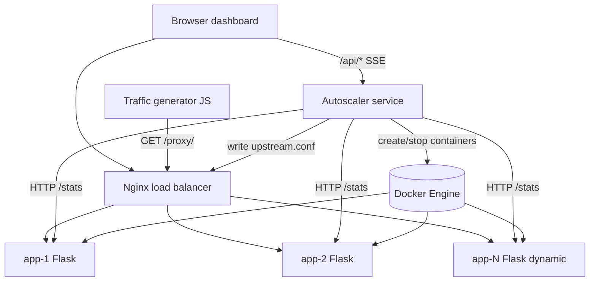

# Local Auto Scaling Demo

Run a **real** auto-scaling stack on your laptop: Flask app instances in Docker, **Nginx** load balancing, and a Python **autoscaler** that creates and stops containers based on load. Includes a web **dashboard** with live metrics and an event log.

---

## Demo video (dashboard & scale in / out)

Recorded walkthrough of the visualizer: instance cards, utilization bars, traffic slider, and containers scaling up and down.

<video controls muted playsinline width="100%" src="https://pub-e1f0ebf03c3f42028d5d4a6e994206a9.r2.dev/scale%20INOUT.mp4">
  Your browser does not support embedded video.
  <a href="https://pub-e1f0ebf03c3f42028d5d4a6e994206a9.r2.dev/scale%20INOUT.mp4">Open the demo video</a> in a new tab.
</video>

[Open demo video in full screen](https://pub-e1f0ebf03c3f42028d5d4a6e994206a9.r2.dev/scale%20INOUT.mp4) · video plays **muted** by default; use the player controls to unmute.

---

## Run it in 3 steps (after clone)

### 1. Prerequisites

| Requirement | Notes |
|-------------|--------|
| [Docker Desktop](https://www.docker.com/products/docker-desktop/) (Windows / macOS) or **Docker Engine** (Linux) | Must be **running** before the next step |
| **Docker Compose v2** | `docker compose version` (not legacy `docker-compose` only) |

**Windows:** Use Docker Desktop with **Linux containers** (WSL2 backend recommended).

### 2. Get the project

```bash
git clone <YOUR_REPO_URL>
cd auto-scaler
```

If you downloaded a ZIP instead of cloning, unzip it and `cd` into the folder that contains `docker-compose.yml`.

### 3. Configure and start

**Linux / macOS / Git Bash:**

```bash
cp .env.example .env
docker compose up --build -d
```

**Windows (PowerShell):**

```powershell
Copy-Item .env.example .env
docker compose up --build -d
```

**Foreground mode** (logs in the terminal; stop with `Ctrl+C`):

```bash
docker compose up --build
```

### 4. Open the dashboard

| URL | Purpose |
|-----|---------|
| **http://localhost:8080** | Dashboard (metrics, traffic, config, event log) |
| **http://localhost:8080/proxy/** | Load-balanced app (used by the traffic generator) |

Change the host port in `.env` with `HOST_PORT=...` if **8080** is already in use, then run `docker compose up --build -d` again.

**Verify containers:**

```bash
docker compose ps
docker ps --filter label=autoscale.role=app
```

You should see **app-1** and **app-2** plus **autoscale-nginx** and **autoscale-autoscaler**.

---

## Try scaling (2-minute test)

1. Open **http://localhost:8080**.
2. Click **Increase load** (or move the slider up) until utilization stays high — watch the **event log** for `HIGH LOAD DETECTED` and new instances (`app-3`, …).
3. Click **Stop traffic** or lower the slider — after the cooldown (~10s), look for `LOW LOAD DETECTED` or `EXCESS CAPACITY DETECTED` and scale-in.
4. Optional: `docker ps` in a terminal to see containers appear and disappear.

See the [demo video](#demo-video-dashboard--scale-in--out) above for the full visual flow.

---

## What is auto scaling?

**Auto scaling** changes how many application copies run based on demand.

| Term | Meaning |
|------|---------|
| **Scale out** | Start more containers when load is high |
| **Scale in** | Remove extra containers when load drops or the cluster has **excess capacity** (never below **minimum**) |

This project uses **real** Docker containers and HTTP traffic—not a UI-only simulation.

## Architecture



### Components

1. **Flask (`app/`)** — Rolling **60s** request window; default **20 req/min** per instance (configurable); **429** when overloaded. `/stats` is excluded from load (monitoring only).
2. **Nginx (`nginx/`)** — Public port **8080**: static dashboard, `/proxy/` → apps, `/api/` → autoscaler. Upstream list in `shared/upstream.conf`.
3. **Autoscaler (`autoscaler/`)** — Scales on utilization and **cluster headroom**, rewrites upstream, reloads Nginx. REST + SSE for the dashboard.
4. **Frontend (`frontend/`)** — Dashboard UI.

### Default scaling policy

| Setting | Default |
|---------|---------|
| Minimum instances | 2 |
| Maximum instances | 5 |
| Capacity per instance | 20 req/min |
| Scale-out | Average utilization **> 80%** |
| Scale-in | Average **< 20%**, **or** total load fits on one fewer instance (≤ 80% of each remaining instance’s capacity) |
| Cooldown | **10 seconds** between scaling actions |

The autoscaler mounts **`/var/run/docker.sock`** (local dev only—see [Security](#security-local-dev-only)).

## Using the dashboard

- **Overview** — Instance count, capacity, requests in last 60s, scaling status (`steady`, `at max`, etc.).
- **Traffic controls** — Slider / buttons send requests to **`/proxy/`** through Nginx.
- **Configuration** — Set min/max instances → **Apply configuration**.
- **Event log** — Live autoscaler messages (SSE).

Example log lines:

```
[23:11:05] HIGH LOAD DETECTED.
[23:11:08] Instance app-3 started.
[23:11:09] Nginx reloaded successfully.
[23:12:30] EXCESS CAPACITY DETECTED.
[23:12:45] Terminating scaled instance app-5.
```

## Environment variables

Created from `.env.example` → `.env`:

| Variable | Default | Description |
|----------|---------|-------------|
| `HOST_PORT` | 8080 | Published Nginx port |
| `MIN_INSTANCES` | 2 | Minimum app containers |
| `MAX_INSTANCES` | 5 | Maximum app containers |
| `CAPACITY_PER_MINUTE` | 20 | Per-instance capacity |
| `SCALE_OUT_THRESHOLD` | 80 | Scale-out utilization % |
| `SCALE_IN_THRESHOLD` | 20 | Low-utilization scale-in % |
| `SCALING_COOLDOWN` | 10 | Cooldown (seconds) |
| `POLL_INTERVAL` | 2 | Autoscaler poll interval |

After editing `.env`, run `docker compose up --build -d` again.

## Detailed experiments

### Experiment 1 — Initial state

`docker compose up --build -d` → dashboard shows **2** instances; `docker ps` shows **app-1**, **app-2**.

### Experiment 2 — Scale out

Increase traffic until utilization > 80% → **app-3** (and more) appear; `curl http://localhost:8080/proxy/` shows different `instance_name` values.

### Experiment 3 — Max instances

Keep increasing load → stops at **max**; event log may show **Maximum instance limit reached**.

### Experiment 4 — Scale in

Lower or stop traffic → wait for cooldown → `LOW LOAD DETECTED` or `EXCESS CAPACITY DETECTED` → extra instances removed; **minimum** count kept.

## API reference

**Per instance** (via `/proxy/` or internal network): `GET /`, `GET /health`, `GET /stats`, **429** when overloaded.

**Via Nginx:** `GET /api/status`, `GET /api/instances`, `POST /api/config`, `GET /api/events` (SSE).

## Useful commands

```bash
docker compose ps
docker compose logs -f autoscaler
docker compose logs -f nginx
docker ps --filter label=autoscale.role=app
cat shared/upstream.conf
```

**Windows:** use `type shared\upstream.conf` instead of `cat`.

## Troubleshooting

| Problem | Fix |
|---------|-----|
| `docker compose` not found | Install Docker Desktop / Engine; use `docker compose`, not only `docker-compose` |
| Port 8080 in use | Set `HOST_PORT=8081` in `.env`, restart compose |
| Dashboard empty | `docker compose logs autoscaler`; ensure all services are `Up` |
| No scale-out | Raise traffic; need ~80% utilization per instance (depends on `CAPACITY_PER_MINUTE`) |
| Won’t scale in after lowering traffic | Wait **60s** for rolling window + **10s** cooldown; or check **EXCESS CAPACITY** logic with your capacity settings |
| Stuck at 3+ instances with 0 traffic | `docker compose up --build -d` (old builds counted `/stats` as load—fixed in current `app.py`) |
| Nginx 502 | `docker compose logs nginx`; check `shared/upstream.conf` matches running `app-*` containers |

## Stop and clean up

```bash
docker compose down
```

Remove scaled instances if needed:

```bash
docker rm -f app-3 app-4 app-5
```

Full local image cleanup:

```bash
docker compose down --rmi local
```

## Security (local dev only)

The autoscaler needs the Docker socket to create/remove containers. Use only on a **trusted** development machine.

## Project layout

```
├── docker-compose.yml
├── docs/                   # optional local assets
├── app/
├── autoscaler/
├── nginx/
├── frontend/
├── shared/upstream.conf
├── .env.example
└── README.md
```

## License

MIT — use and modify for learning and demos.