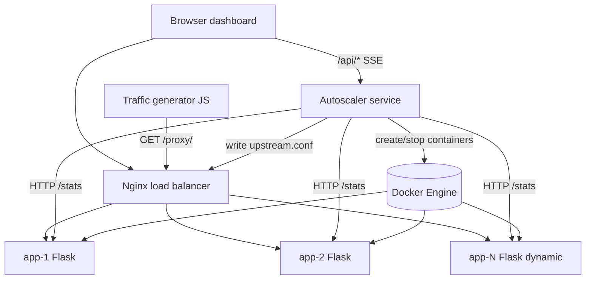

# Local Auto Scaling Demo

Educational project that demonstrates **horizontal auto scaling** on your machine: a Python autoscaler watches real Flask app containers, adds or removes Docker instances based on load, and keeps an **Nginx** load balancer in sync—no cloud or Kubernetes required.

## What is auto scaling?

**Auto scaling** adjusts how many copies of an application run based on demand. When load rises, the system **scales out** (adds instances). When load falls, it **scales in** (removes extra instances).

| Term | Meaning |
|------|---------|
| **Scale out** | Start more application containers to handle higher traffic |
| **Scale in** | Stop extra containers when traffic drops or the cluster has **excess capacity** (never below the configured minimum) |

This demo uses **real** Docker containers and **real** HTTP traffic—not a frontend-only simulation.

## Architecture



### Components

1. **Flask app (`app/`)** — One container = one instance. Tracks requests in a rolling **60-second** window. Capacity defaults to **20 requests/minute** per instance; overload returns **HTTP 429**.
2. **Nginx (`nginx/`)** — Single public entry (port **8080**). Round-robin to `upstream backend`. Upstream list lives in `shared/upstream.conf` and is **not** hardcoded in `nginx.conf`.
3. **Autoscaler (`autoscaler/`)** — Polls `/stats` on every labelled app container, computes average utilization, scales out/in, rewrites upstream, runs `nginx -s reload` in the Nginx container. Exposes REST + **Server-Sent Events** for the dashboard.
4. **Frontend (`frontend/`)** — Dashboard metrics, traffic controls, min/max config, live event log.

### Default scaling policy

| Setting | Default |
|---------|---------|
| Minimum instances | 2 |
| Maximum instances | 5 |
| Capacity per instance | 20 req/min |
| Scale-out threshold | 80% average utilization |
| Scale-in threshold | 20% average utilization, **or** total load fits on one fewer instance within the scale-out headroom (80% of capacity per instance) |
| Scaling cooldown | 10 seconds |

The autoscaler never runs more than **max** instances or fewer than **min**. Scale-in only removes instances **above** the minimum (e.g. `app-3`, `app-4`, …).

## Prerequisites

- [Docker Desktop](https://www.docker.com/products/docker-desktop/) (Windows/macOS) or Docker Engine (Linux)
- Docker Compose v2 (`docker compose`)

## Quick start

```bash
cd auto-scaler
cp .env.example .env
docker compose up --build -d
```

Open the dashboard: **http://localhost:8080**

Only port **8080** is published on the host (Nginx). App containers and the autoscaler are internal to the Docker network `autoscale-net`.

### Security note (local dev only)

The autoscaler mounts **`/var/run/docker.sock`** so it can create and remove containers. That grants significant control over the host Docker daemon. Use this project **only** on trusted development machines.

## Using the dashboard

### Overview

Shows active instance count, min/max limits, total capacity, aggregate requests in the last 60 seconds, average utilization, and scaling status.

### Traffic controls

- **Increase load / Decrease load / slider** — Sets how many requests per second the browser sends to **`/proxy/`** (through Nginx to the app pool).
- **Stop traffic** — Sets rate to 0.

Use **Increase load** until average utilization stays above **80%** to trigger scale-out. Lower traffic and wait for sustained low utilization (below **20%** for at least the cooldown) to trigger scale-in.

### Configuration

Set **minimum** and **maximum** instances and click **Apply configuration**. Values are sent to the autoscaler (`POST /api/config`) and enforced on the next scaling decisions.

### Event log

Live lines from the autoscaler (SSE `/api/events`), for example:

```
[23:11:05] HIGH LOAD DETECTED.
[23:11:05] Average utilization: 95%.
[23:11:06] Creating new instance...
[23:11:08] Instance app-3 started.
[23:11:09] Updating Nginx configuration.
[23:11:09] Nginx reloaded successfully.
```

## How Nginx stays in sync

1. Autoscaler lists containers with label `autoscale.role=app`.
2. It writes `shared/upstream.conf`:

   ```nginx
   upstream backend {
       server app-1:5000;
       server app-2:5000;
   }
   ```

3. After changes, it runs `nginx -t` and `nginx -s reload` **inside** the `autoscale-nginx` container (graceful reload).

New instances are polled at `/health` before being added to upstream. On scale-in, Nginx is updated **before** the container is stopped.

## Walkthrough experiments

### Experiment 1: Initial state

```bash
docker compose up --build -d
docker ps --filter label=autoscale.role=app
```

Expect **app-1** and **app-2** running. Dashboard shows 2 instances.

### Experiment 2: Scale out

1. Open http://localhost:8080
2. Click **Increase load** several times (or set slider ≥ 15–20 req/s).
3. Watch the event log for `HIGH LOAD DETECTED` and `Instance app-3 started`.
4. Confirm: `docker ps` shows `app-3`.
5. Hit Nginx: `curl http://localhost:8080/proxy/` repeatedly—responses show different `instance_name` values.

### Experiment 3: Scale further

Keep increasing traffic. New containers `app-4`, `app-5` may appear. At 5 instances, logs show **Maximum instance limit reached**.

### Experiment 4: Scale in

Click **Stop traffic** or **Decrease load**. After utilization stays low and cooldowns elapse, watch `LOW LOAD DETECTED` and termination of `app-5`, `app-4`, etc. **app-1** and **app-2** remain.

## Flask API (per instance)

| Endpoint | Description |
|----------|-------------|
| `GET /` | Name, ID, requests in last 60s, capacity, utilization % |
| `GET /health` | Health JSON |
| `GET /stats` | Same metrics as `/` |
| (overload) | **429** when rolling 60s count ≥ capacity |

Instances are reached via Nginx at `http://localhost:8080/proxy/` or directly on the Docker network at `http://app-1:5000/`.

## Autoscaler API (via Nginx)

| Method | Path | Purpose |
|--------|------|---------|
| GET | `/api/status` | Cluster overview |
| GET | `/api/instances` | Per-container stats |
| POST | `/api/config` | `{ "min_instances", "max_instances" }` |
| GET | `/api/events` | SSE event stream |

## Environment variables

Copy `.env.example` to `.env`:

| Variable | Default | Description |
|----------|---------|-------------|
| `HOST_PORT` | 8080 | Host port for Nginx |
| `MIN_INSTANCES` | 2 | Minimum app containers |
| `MAX_INSTANCES` | 5 | Maximum app containers |
| `CAPACITY_PER_MINUTE` | 20 | Per-instance capacity |
| `SCALE_OUT_THRESHOLD` | 80 | Avg utilization % to scale out |
| `SCALE_IN_THRESHOLD` | 20 | Avg utilization % to scale in |
| `SCALING_COOLDOWN` | 10 | Seconds between scaling actions / low-load wait |
| `POLL_INTERVAL` | 2 | Autoscaler poll interval (seconds) |

## Useful Docker commands

```bash
docker compose ps
docker compose logs -f autoscaler
docker compose logs -f nginx
docker ps --filter label=autoscale.role=app
docker inspect app-3 --format '{{.State.Status}}'
cat shared/upstream.conf
```

## Troubleshooting

| Problem | What to check |
|---------|----------------|
| Dashboard empty / API errors | `docker compose logs autoscaler`; ensure `autoscale-autoscaler` is running |
| No scale-out | Traffic may be too low; each instance needs ~16+ requests in 60s for 80% at capacity 20 |
| Instances stay at 3+ with traffic at 0 | Old app images counted autoscaler `/stats` polls as load; rebuild with `docker compose up --build -d`. Scale-in needs avg utilization below 20% for the full cooldown (10s) after the rolling 60s window clears |
| One instance shows high requests, others 0 | Usually leftover traffic in the 60s window on that instance, or an old build where `/stats` polls filled the counter |
| Scale-out fails | `docker compose logs autoscaler`; confirm Docker socket mount and image `autoscale-app:latest` exists (`docker images`) |
| Nginx 502 | Upstream lists a dead host; check `shared/upstream.conf` and app container health |
| Windows socket issues | Use Docker Desktop with Linux containers; WSL2 backend recommended |

## Stop and clean up

```bash
docker compose down
```

Remove dynamically created containers if any remain:

```bash
docker rm -f app-3 app-4 app-5 2>/dev/null
```

Optional full cleanup including images:

```bash
docker compose down --rmi local -v
```

## Project layout

```
├── docker-compose.yml
├── app/
├── autoscaler/
├── nginx/
├── frontend/
├── shared/upstream.conf
├── .env.example
└── README.md
```

## License

MIT — use and modify for learning and demos.